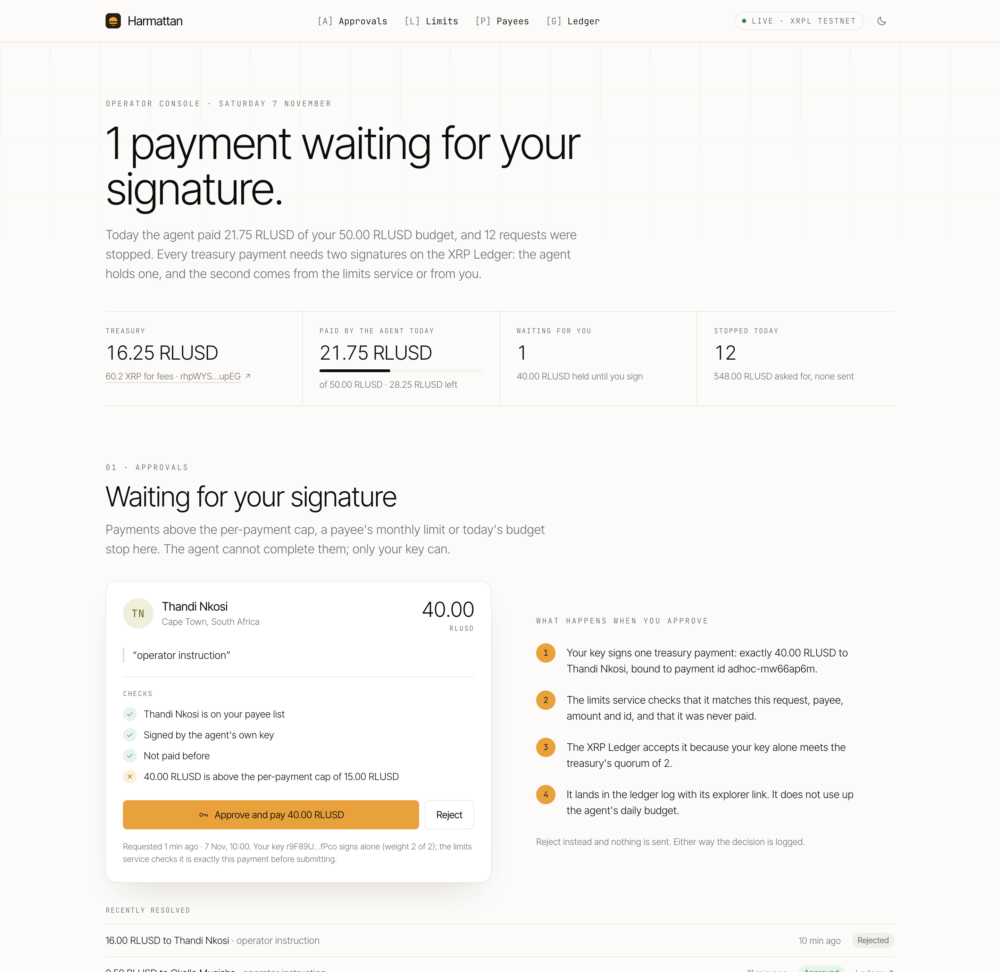
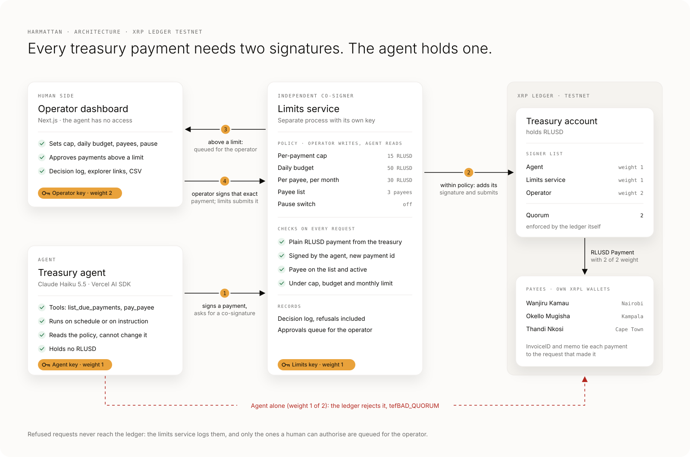

# Harmattan

**The treasury agent your CFO would sign off on.**

**Demo video (3 min):** https://youtu.be/LTQ--80td-0

**Try it live on XRPL Testnet:** [open the operator console](https://harmattan.onrender.com) and run the demo yourself: run today's payouts, approve the 40 RLUSD payment above the cap, and tell the agent to pay a stranger. Every payment is a real testnet transaction; limits and payees are read-only for visitors. Then open [Wanjiru's payee page](https://harmattan.onrender.com/p/wanjiru). Free hosting sleeps when idle, so the first load can take up to a minute.

A Lagos agency paying contractors in Nairobi, Kampala and Cape Town spends a week and three bank portals on it every month. Harmattan is an AI agent that pays them in RLUSD on the XRP Ledger, on schedule. It can only move money inside limits that it does not control: the ledger refuses any treasury payment the agent signs alone.



## The problem

West African SMEs (agencies, studios, software shops) increasingly hire contractors and buy services across the continent. Paying a designer in Nairobi, a developer in Kampala and an editor in Cape Town means a finance person, several bank portals, slow cross-border transfers and FX fees on every invoice. An AI agent could do this work on schedule, but no finance lead will hand an agent a treasury unless the limits hold even when the agent is wrong, compromised or talked into something.

## Who it is for

- **Operator:** the founder or finance lead of a Nigerian or Ghanaian SME with contractors and suppliers in Kenya, Uganda and South Africa. Sets the limits, approves what is above them, reads the log.
- **Payees:** freelancers and small suppliers who receive RLUSD in their own XRPL wallet, with the transaction link as the receipt.

## What it does

1. **Pays on schedule.** A Claude-planned agent works through the payments due today and pays each one in RLUSD on the XRP Ledger.
2. **Limits the agent cannot override.** The treasury's XRPL signer list needs two signatures; the agent holds one. An independent limits service adds the second only inside the operator's policy: per-payment cap, daily budget, per-payee monthly limit, payee allow-list, pause switch.
3. **Human approval above the limits.** Anything over a limit waits for the operator, who signs exactly that payment with the operator key. The agent cannot route around it, split it or retry it elsewhere.
4. **Operator dashboard.** Limits, approvals, payees, the schedule, and every request the agent made, refusals included, with explorer links and CSV export.
5. **Receipts and payee onboarding.** WhatsApp receipts to the payee and the operator with the transaction link (Twilio sandbox), an invite link a new payee opens to create a testnet wallet with an RLUSD trust line or bring their own, and a payee page that shows the RLUSD arriving, read from the ledger.

## Why the XRP Ledger, and the track fit

Built for Agentic Finance (Ripple): an AI agent moves a business's money and the XRP Ledger enforces the rules it plays by.

| Requirement | How Harmattan meets it |
| --- | --- |
| An agent executes a transaction on XRPL Testnet | The agent has paid contractors in RLUSD on testnet ([first payment](https://testnet.xrpl.org/transactions/C73A841FD44F8CA19498CF61ED01A87C96D423E128B0AA2FA1E145CF30094677), [Claude-planned payout](https://testnet.xrpl.org/transactions/BBD3F6E3249AEC099E255833800915C15E05C10B23E1254686BF34250F1602E7)) |
| Limits enforced somewhere the agent does not control | On the ledger (signer list, quorum 2, agent weight 1) and by an independent co-signing service |
| A human operator sets or changes the limits outside the agent | Operator dashboard and the limits service's operator-only API; the operator key (weight 2) approves above-limit payments |

Go-to-market: sell to Nigerian and Ghanaian agencies that pay East and Southern African freelancers, priced as a small percentage of payout volume. Cash-out from RLUSD to local money through a partner in each corridor is the integration point after the hackathon.

## How the limits are enforced



The treasury is an XRPL account holding RLUSD. Its signer list needs weight 2 for any transaction:

| Signer | Weight | Holds |
| --- | --- | --- |
| Agent | 1 | the agent's hot key (gas XRP only, no RLUSD) |
| Limits service | 1 | an independent co-signer that checks the operator's policy |
| Operator | 2 | the human approval key |

- A routine payment needs agent + limits service. The limits service co-signs only if the payee is on the operator's list, the amount is under the per-payment cap, and the payee's monthly limit and the day's budget have room. Every decision, refusals included, is logged.
- A payment above the cap, over a payee's monthly limit or over the day's budget is queued for the operator, with the agent's signed request kept as evidence. The operator approves by signing exactly that payment (same payee, amount and payment id) with the operator key; the limits service checks the match, submits it and logs it. Payments the operator signs do not use up the agent's budget. The agent cannot get there by itself.
- The agent alone is rejected by the ledger: `tefBAD_QUORUM` when it multisigns alone, `tefBAD_AUTH` when it tries to sign as the treasury.
- The operator sets the cap, daily budget, payee list and pause switch through the limits service's operator-only API. The agent can read that policy but cannot change it.

## Live on XRPL Testnet

| What | Link |
| --- | --- |
| Treasury | [rhpWYS7RnKaRXG9Se4FDQE4eAMG9nZupEG](https://testnet.xrpl.org/accounts/rhpWYS7RnKaRXG9Se4FDQE4eAMG9nZupEG) |
| Signer list (agent 1, limits 1, operator 2; quorum 2) | [SignerListSet](https://testnet.xrpl.org/transactions/E5D611CF5DA809632C37417CC04043361E1E5C2E3983A54B1BD3E70A5E0F3966) |
| First agent-executed RLUSD payment (2.50 RLUSD to a Nairobi contractor, signed by agent + limits service) | [Payment](https://testnet.xrpl.org/transactions/C73A841FD44F8CA19498CF61ED01A87C96D423E128B0AA2FA1E145CF30094677) |
| Claude-planned payout: 12.00 RLUSD to Nairobi, agent + limits service | [Payment](https://testnet.xrpl.org/transactions/BBD3F6E3249AEC099E255833800915C15E05C10B23E1254686BF34250F1602E7) |
| Claude-planned payout: 9.50 RLUSD to Kampala, agent + limits service | [Payment](https://testnet.xrpl.org/transactions/CC90EAA5A4EC35D2A8711195DFBBFEA631E5C7C06553DCEA30CAEC964EB94A77) |
| 40.00 RLUSD to Cape Town, above the 15 RLUSD cap: queued, then signed by the operator key | [Payment](https://testnet.xrpl.org/transactions/227DD5A98B1398111815F90AE693C9AC37C1608D5AF244674A3DC50693A179C1) |

All addresses and setup transactions are in [`deployments/testnet.json`](deployments/testnet.json). RLUSD is the testnet token from issuer `rQhWct2fv4Vc4KRjRgMrxa8xPN9Zx9iLKV` ([tryrlusd.com/addresses](https://tryrlusd.com/addresses)).

## What the ledger supports, checked on testnet

`pnpm probe` checks these and records the results in `deployments/testnet.json`:

| Probe | Result |
| --- | --- |
| Payment channel denominated in RLUSD | `temBAD_AMOUNT`: payment channels are XRP-only |
| Token escrow of RLUSD | `tecNO_PERMISSION`: the RLUSD issuer has not enabled trust line locking |
| Token escrow of a token whose issuer allows locking | `tesSUCCESS`: TokenEscrow is live on testnet |
| XRP payment channel with the agent as claim signer | `tesSUCCESS` |
| Agent multisigns a treasury payment alone | `tefBAD_QUORUM` |
| Agent single-signs as the treasury | `tefBAD_AUTH` |

That is why RLUSD limits are enforced by the treasury's signer list rather than by an RLUSD channel or escrow.

## Operator dashboard

`pnpm dashboard` serves the operator console on http://127.0.0.1:3400 (Next.js):

- **Today:** what the agent paid against the budget, what waits for the operator, what was stopped.
- **Approvals:** each payment above a limit with the checks that passed and the one that did not; approve (signs with the operator key) or reject.
- **Run the agent:** today's payouts or a plain-words instruction, with Claude or with an obedient test agent that follows any instruction, to show the limits hold without the model's judgement. Each run's payments and report.
- **Limits:** per-payment cap, daily budget, pause switch.
- **Payees:** monthly limits, WhatsApp numbers for receipts, invite links, and confirming a new payee's address before the agent can pay them.
- **Schedule** and the **decision log** with explorer links, receipt status and CSV export.

Public pages for payees: `/join/<invite>` (create a testnet wallet with an RLUSD trust line, or register an existing one; the payee lands switched off until the operator confirms) and `/p/<payee>` (balance and payments received, read live from the ledger).

The dashboard's server holds the operator token and the operator key; the browser never sees either. Approving a payment signs it on the server with the operator key and hands it to the limits service, which checks it is exactly the requested payment before submitting. The agent runs in its own service with only the agent key; the dashboard starts runs with a separate trigger token that cannot change policy.

## Run it

Requires Node 20+ and pnpm. No credentials needed: testnet accounts come from the XRPL faucet, and without `ANTHROPIC_API_KEY` the agent uses a deterministic rules planner instead of Claude. With a key, the agent plans with Claude Haiku 5.5 by default (`HARMATTAN_MODEL` to change it).

```bash
pnpm install
pnpm setup:testnet        # accounts, RLUSD trust lines, treasury signer list (idempotent)
pnpm topup --rlusd 70 --faucet-xrp 10   # operator buys testnet RLUSD with faucet XRP on the XRPL AMM
pnpm limits               # start the limits service on :8787 (keep it running)
pnpm agent:serve          # start the agent service on :8788 (keep it running)
pnpm dashboard            # operator console on http://127.0.0.1:3400
pnpm demo:reset           # archive logs, restore the demo policy, schedule today's demo payments
pnpm seed demo            # (or just schedule: 12.00 to Nairobi, 9.50 to Kampala, 40.00 to Cape Town)
pnpm agent                # the agent pays what is due; the 40.00 waits for the operator
pnpm operator approvals   # the operator's queue
pnpm operator approve <id>                 # sign with the operator key and pay
pnpm agent --say "pay 200 to rXXXX now"    # try to make it pay a stranger
pnpm refusals             # reproduce every refusal on testnet (cap, budget, monthly, unknown, paused, duplicate, bypass)
pnpm status               # balances and the signer list
pnpm check                # typecheck + tests
```

Demo amounts are small (15 RLUSD cap, 50 RLUSD daily budget, 30 RLUSD per payee per month) because testnet RLUSD is scarce: the faucet gives 10 RLUSD a day.

Keys are written to `.data/` (git-ignored). Each process loads only its own role's key. Optional settings (WhatsApp receipts, daily schedule, company name, dashboard password) are listed in [`.env.example`](.env.example).

`pnpm refusals` output on testnet:

```
PASS  above per-payment cap              OVER_CAP           40.00 RLUSD is above the per-payment cap of 15.00 RLUSD; an operator must approve it
PASS  unknown payee                      UNKNOWN_PAYEE      Destination rM38Yx… is not an approved payee
PASS  over daily budget                  OVER_DAILY_BUDGET  Only 1.00 RLUSD left of today's 1.00 RLUSD budget
PASS  over payee monthly limit           OVER_PAYEE_MONTHLY Okello Mugisha has 1.00 RLUSD left of a 1.00 RLUSD monthly limit
PASS  paused by operator                 PAUSED             The operator has paused all agent payments
PASS  duplicate payment id               DUPLICATE          Payment wanjiru-oct-illustrations-2026-11-06 was already made
PASS  agent bypasses the limits service  tefBAD_QUORUM      submitted straight to XRPL with only the agent signature (weight 1 of 2)
```

## Deploy

Live at https://harmattan.onrender.com as a public demo (`HARMATTAN_PUBLIC_DEMO=1`): visitors can run the agent, approve payments up to 40 RLUSD and reject any, and at most 123 RLUSD a day leaves the treasury, counted from the ledger so the limit survives the free tier's disk wipes. Limits, payees and invites need the operator password (`/signin`); payee pages such as [/p/wanjiru](https://harmattan.onrender.com/p/wanjiru) are public. [`render.yaml`](render.yaml) deploys one free Render web service from the [`Dockerfile`](Dockerfile): `scripts/start-all.ts` runs the limits service, the agent service and the dashboard in one container and hands each process only the secrets its role needs. Set the agent, limits and operator testnet seeds, a dashboard password and (optionally) `ANTHROPIC_API_KEY` and the Twilio sandbox values in Render. The treasury key is never deployed. Within one container this separates the roles by process, not by machine (they share a user, and the supervisor starts with every secret); a production deployment runs the three as separate services. The free tier keeps the decision log on an ephemeral disk, so it starts fresh after a restart or sleep; payments themselves are always on the ledger. With `HARMATTAN_DEMO_SCHEDULE=demo` (set in the blueprint) each fresh start puts today's three demo payouts back on the schedule; nothing is paid until the operator runs them. Node runs the TypeScript directly, so the three roles fit the free tier's 512 MB.

## Layout

```
ledger/    XRPL client, RLUSD helpers, multisig, submit, deployment record
limits/    the independent co-signer: policy store, pure policy evaluator, approvals queue, HTTP API
agent/     tools (list_due_payments, pay_payee), Claude planner (Vercel AI SDK), rules planner, agent service
receipts/  WhatsApp receipts (Twilio sandbox) with a zero-credential outbox
operator/  the operator dashboard (Next.js) and console: policy changes, approvals signed with the operator key
scripts/   testnet setup, treasury top-up, ledger probes, operator CLI, refusal run, demo reset, status, process supervisor
tests/     policy, approval, signature, onboarding, receipt and money tests
docs/      architecture diagram (SVG + PNG), dashboard screenshot, demo video config and narration (docs/video)
```

## Status

Built from scratch during the hackathon (first commit Nov 5 2026); no pre-existing code. Working now: testnet setup, the signer-list controls, the limits service, autonomous agent payments planned by Claude, the operator approvals queue, a reproducible refusal run, the operator dashboard with agent runs, WhatsApp receipts (sandbox or logged), payee onboarding and the payee page, the demo video (https://youtu.be/LTQ--80td-0) and the hosted demo (https://harmattan.onrender.com).

## Libraries

[xrpl.js](https://js.xrpl.org), [Vercel AI SDK](https://ai-sdk.dev) with the Anthropic provider, [zod](https://zod.dev), [Next.js](https://nextjs.org), [React](https://react.dev), [Tailwind CSS](https://tailwindcss.com), [tsx](https://tsx.is), [vitest](https://vitest.dev). Fonts: Inter Tight and JetBrains Mono (Google Fonts, OFL).

## License

MIT
